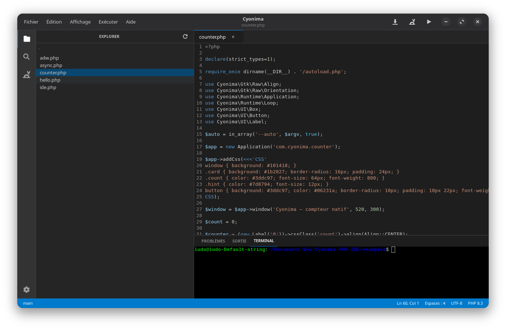

# Cyonima-PHP-IDE

Un IDE pour PHP 8 et un compilateur d'applications desktop natives.

Deux axes, un même socle :

- **Le runtime** : des applications PHP avec une UI **native GTK4** (pas de
  WebView, pas de serveur HTTP), empaquetées en exécutables Linux autonomes.
- **L'IDE** : un environnement de développement PHP écrit lui-même en PHP, avec
  des widgets natifs, un éditeur GtkSourceView et un terminal VTE.

## État du projet

| Jalon | État |
|---|---|
| M0 — Spike de faisabilité | ✅ terminé |
| M1 — Générateur de bindings | ✅ tranche verticale Gtk (7 classes, 54 méthodes, différentiel PyGObject) |
| M2 — Runtime + façade OO | ✅ boucle à source unique, fibres, sous-processus, erreurs, `Application` |
| M3 — libadwaita | ✅ HeaderBar, ToolbarView, Clamp, Preferences, SwitchRow, Toast |
| M4 — GtkSourceView / VTE | ✅ éditeur PHP coloré, terminal PTY, mini-IDE de démonstration |
| M5 — IDE MVP | 🟡 design inspiré de Visual Studio, navigation, édition, terminal, LSP, Xdebug ; reste la recherche projet |
| M6 — Packaging | ✅ portable, **Flatpak construit et exécuté**, **AppImage autonome (PHP + GTK, 44 Mo)** |

Prérequis : PHP 8.3+ avec l'extension FFI, GTK4 (runtime), un serveur X/Wayland.

## Démarrage

Aucune dépendance PHP externe : un autoloader PSR-4 suffit. Composer reste
optionnel pour le développement.

```bash
# Génère les bindings depuis les .typelib (aucun paquet -dev requis)
composer generate

# Applications de démonstration (--auto = scénario scripté)
composer demo -- --auto
composer demo:async -- --auto
composer demo:adw -- --auto
composer demo:ide -- --auto

# LSP optionnel (ici avec le faux serveur des tests)
CYONIMA_LSP="php tests/fixtures/fake_lsp.php" \
  php -d ffi.enable=true examples/ide.php --auto

# Tests
composer test
```

## Exemple : UI native + handler PHP

```php
use Cyonima\Runtime\Application;
use Cyonima\UI\{Box, Button, Label};

$app = new Application('com.example.counter');
$count = 0;

$label = new Label('0');
$button = (new Button('Incrémenter'))->onClicked(function () use (&$count, $label) {
    $count++;
    $label->text((string) $count);
});

$window = $app->window('Démo', 420, 220);
$window->setChild(new Box(spacing: 12)->append($label, $button))->present();
$app->run();   // retourne à la fermeture de la dernière fenêtre
```

## Exemple : asynchrone sans figer l'UI

```php
use Cyonima\Runtime\{Async, Process};

$button->onClicked(function () use ($status) {
    $status->text('Tâche en cours…');

    // Sous-processus : le calcul ne bloque pas la boucle GTK.
    $result = Async::await(Process::php('usleep(900000); echo "OK";'));

    $status->text('Terminé : ' . $result->output());
});
```

Deux niveaux : **fibres coopératives** pour l'I/O et les séquences,
**sous-processus** pour le CPU. Détail dans [`docs/runtime.md`](docs/runtime.md).

## Exemple : fenêtre libadwaita

```php
use Cyonima\Runtime\AdwApplication;
use Cyonima\UI\{ActionRow, Clamp, PreferencesGroup, PreferencesPage, SwitchRow};

$app = new AdwApplication('com.example.reglages');
$page = (new PreferencesPage('Réglages', 'Construit depuis PHP'))
    ->add((new PreferencesGroup('Apparence'))
        ->add(new SwitchRow('Mode compact', 'Réduit les marges')));

$window = $app->window('Cyonima', 'libadwaita · GTK4 · PHP');
$window->content(new Clamp($page, 560))->present();
$app->run();
```

## Architecture

```
app PHP  →  Cyonima\UI         façade typée, écrite à la main
         →  Cyonima\Gtk\Raw    bindings générés depuis les .typelib
         →  FFI                un seul cdef, un seul dlopen
         →  GTK4 · Adw · GtkSourceView · VTE

runtime  →  Loop (un tick GLib)  →  Scheduler (fibres)
                                 →  Process (sous-processus)
                                 →  Errors (report unique)
```

Le typelib est la source de vérité des bindings : une méthode absente de l'API
fait échouer la génération, et un test différentiel contre PyGObject vérifie
l'interprétation.

## Exemple : mini IDE

`examples/ide.php` assemble : navigateur de projet (`FileBrowser`), éditeur
GtkSourceView avec ouverture/sauvegarde réelles, terminal VTE, exécution du
fichier courant, et client LSP optionnel (`CYONIMA_LSP`).

Avec un serveur LSP, `Ctrl+Espace` ouvre le popover de complétion ; les flèches
naviguent, `Entrée` insère, `Échap` ferme. Sans serveur, le reste de l'IDE
fonctionne normalement.

## Débogage Xdebug

L'IDE écoute sur `127.0.0.1:9003` (`CYONIMA_XDEBUG_PORT` pour changer). Avec
Xdebug installé :

```bash
XDEBUG_MODE=debug XDEBUG_SESSION=1 php chemin/script.php
```

Cliquer « Déboguer » dans l'IDE : la session se connecte, un point d'arrêt est
posé sur le fichier courant, et chaque pause ouvre le fichier à la bonne ligne.
Pas-à-pas (`step_into`/`step_over`/`step_out`), reprise et arrêt sont pilotés
par le protocole DBGp.

```php
use Cyonima\Runtime\AdwApplication;
use Cyonima\UI\{CodeEditor, Paned, ScrolledWindow, Terminal};

$app = new AdwApplication('com.example.ide');
$editor = new CodeEditor('php', $source);
$terminal = new Terminal();
$terminal->spawn(['/bin/bash']);

$window = $app->window('Éditeur', 'GtkSourceView · VTE');
$window->content(
    (new Paned())->start(new ScrolledWindow($editor))->end($terminal),
)->present();
$app->run();
```

Le bouton « Exécuter » de `examples/ide.php` écrit le contenu de l'éditeur dans
un fichier temporaire et l'envoie au shell du terminal.

## Design

Interface inspirée de Visual Studio : barre d'activité, panneau latéral
redimensionnable, onglet d'éditeur, panneau terminal et barre de statut bleue.
IntelliSense intégré (suggestions PHP sans serveur, ou LSP si configuré).
Détail dans [`docs/design.md`](docs/design.md).



## Packaging

```bash
packaging/build-portable.sh      # dist/cyonima-0.1.0-linux-x86_64.tar.gz
./dist/cyonima-0.1.0/bin/cyonima --auto
packaging/test-portable.sh       # vérifie le bundle de bout en bout
php packaging/check.php          # manifeste, desktop, icône, lanceurs
packaging/test-flatpak.sh        # vérifie le Flatpak installé
packaging/appimage/build-php.sh   # PHP embarqué (une fois)
packaging/appimage/build-appimage.sh   # AppImage PHP + GTK
packaging/test-appimage.sh        # vérifie l'AppImage
```

Voir [`packaging/README.md`](packaging/README.md) pour AppImage et Flatpak.

## Documents

- [`docs/etude-faisabilite.md`](docs/etude-faisabilite.md) — mesures, risques, plan
- [`docs/decisions.md`](docs/decisions.md) — ADR et règles techniques (R1/R2)
- [`docs/generateur.md`](docs/generateur.md) — fonctionnement du générateur
- [`docs/runtime.md`](docs/runtime.md) — boucle, fibres, processus, erreurs
- [`docs/design.md`](docs/design.md) — thème et disposition inspirés de Visual Studio
- [`spike/`](spike/README.md) — POC de faisabilité et mesures de fuite

## Décisions actées

| # | Décision |
|---|---|
| ADR-001 | Stack GNOME complet : GTK4 + libadwaita + GtkSourceView5 + VTE |
| ADR-002 | Bindings bruts générés (`Cyonima\Gtk\Raw`) + façade OO (`Cyonima\UI`) |
| ADR-003 | UI impérative retained-mode, sans moteur de re-render |
| ADR-004 | PHP 8.3 minimum |
| ADR-005 | Flatpak pour l'IDE, AppImage avec GTK bundlé pour les apps produites |
