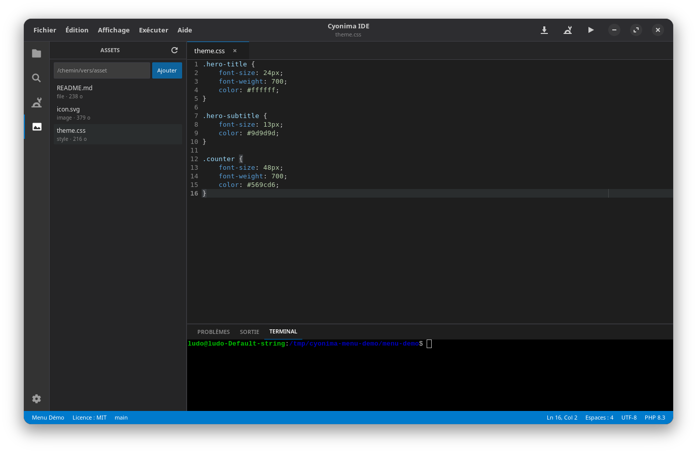

# Cyonima IDE

Un IDE pour PHP 8 et un compilateur d'applications desktop natives.

Cyonima IDE est distribué sous **MIT**, en open source.

Deux axes, un même socle :

- **Le runtime** : des applications PHP avec une UI **native GTK4** (pas de
  WebView, pas de serveur HTTP), empaquetées en exécutables Linux autonomes.
- **L'IDE** : un environnement de développement PHP écrit lui-même en PHP, avec
  des widgets natifs, un éditeur GtkSourceView et un terminal VTE.

## État du projet

| Jalon | État |
|---|---|
| M0 — Spike de faisabilité | ✅ terminé |
| M1 — Générateur de bindings | ✅ tranche verticale Gtk (7 classes, 54 méthodes, différentiel PyGObject) |
| M2 — Runtime + façade OO | ✅ boucle à source unique, fibres, sous-processus, erreurs, `Application` |
| M3 — libadwaita | ✅ HeaderBar, ToolbarView, Clamp, Preferences, SwitchRow, Toast |
| M4 — GtkSourceView / VTE | ✅ éditeur PHP coloré, terminal PTY, mini-IDE de démonstration |
| M5 — IDE MVP | 🟡 design inspiré de Visual Studio, fenêtre de démarrage, projets, licences de projet, assets, concepteur d’interface, édition, terminal, LSP, Xdebug ; reste la recherche projet |
| M6 — Packaging | ✅ portable, **Flatpak construit et exécuté**, **AppImage autonome (PHP + GTK, 56 Mo)** |

Prérequis : PHP 8.3+ avec l'extension FFI, GTK4 (runtime), un serveur X/Wayland.

## Démarrage

Aucune dépendance PHP externe : un autoloader PSR-4 suffit. Composer reste
optionnel pour le développement.

```bash
# Fenêtre de démarrage (création / ouverture de projet)
./bin/cyonima
./bin/cyonima --project=/chemin/du/projet
./bin/cyonima --auto                # démonstration scriptée

# Génère les bindings depuis les .typelib (aucun paquet -dev requis)
composer generate

# Applications de démonstration (--auto = scénario scripté)
composer demo -- --auto
composer demo:async -- --auto
composer demo:adw -- --auto
composer demo:ide -- --auto

# LSP optionnel (ici avec le faux serveur des tests)
CYONIMA_LSP="php tests/fixtures/fake_lsp.php" \
  php -d ffi.enable=true examples/ide.php --auto

# Tests
composer test
```

## Fenêtre de démarrage


Au lancement normal, Cyonima affiche un choix de modèles inspiré de Visual
Studio :

| Modèle | Contenu |
|---|---|
| **Application GTK4** | fenêtre libadwaita, thème du projet, compteur d'exemple |
| **Application console** | script PHP 8.3 sans interface |
| **Bibliothèque** | classe `App\Greeter`, autoload PSR-4 et test |

La création produit un environnement dédié :

```
Mon Projet/
├── .cyonima/project.json   manifeste (modèle, licence, assets)
├── assets/                 icône SVG, thème CSS, assets importés
├── src/main.php            point d'entrée
├── autoload.php            runtime Cyonima + autoload du projet
├── LICENSE                 texte de la licence choisie
├── README.md
└── .gitignore
```

Le manifeste est la source de vérité : nom, identifiant d'application, modèle,
licence SPDX et liste des assets. L'IDE lit `CYONIMA_PROJECT` et se lance sur ce
projet dans un processus séparé (`--project`).

### Licences des projets

Chaque projet choisit sa licence à la création : **MIT**, **Apache-2.0**,
**GPL-3.0** ou **propriétaire**. Le texte correspondant est écrit dans
`LICENSE` et le manifeste enregistre l'identifiant SPDX.

Après création, la vue **PROPRIÉTÉS** de l'IDE (icône engrenage) affiche les
métadonnées du projet et permet de changer la licence. `LICENSE` et
`.cyonima/project.json` sont réécrits, et la barre de statut se met à jour.


Cyonima IDE lui-même est distribué sous **MIT**, en open source : aucune clé
d'activation, aucun plan payant, aucun appel réseau.

### Assets



Chaque projet reçoit une icône SVG et un thème CSS. Le panneau **ASSETS** de
l'IDE liste les fichiers de `assets/`, importe un fichier par son chemin
(relatif au projet ou absolu), met à jour le manifeste et ouvre l'asset choisi
dans l'éditeur.

### Concepteur d'interface


La vue **Concepteur d’interface** (icône pinceau de la barre d’activité, ou
menu **Affichage**) permet de dessiner plusieurs formulaires sans écrire de
code :

- liste des **formulaires du projet** et création de nouveaux formulaires ;
- palette de contrôles : texte, bouton, champ de saisie, interrupteur,
  **image**, **vidéo** et séparateur ;
- ajout par clic ou **glisser-déposer** sur le canevas ;
- sélection, déplacement à la souris et redimensionnement via les propriétés ;
- nom du contrôle et événements prédéfinis ;
- **image à l’intérieur d’un bouton** : chemin d’asset + libellé ;
- édition du texte, du chemin d’asset, de la position et de la taille ;
- suppression d’un contrôle ;
- enregistrement du modèle et génération du code PHP.

Le concepteur écrit un jeu de fichiers par formulaire :

```
.cyonima/forms/main-form.form.json   modèle du formulaire
src/Forms/MainFormBase.php           classe générée (propriétés + événements)
src/Forms/MainForm.php               sous-classe utilisateur (actions)
```

Les images et vidéos utilisent un chemin d’asset relatif au projet
(`assets/logo.png`, `assets/intro.mp4`). Le bouton **Choisir un fichier**
ouvre un sélecteur des assets du projet ; **Parcourir le système…** ouvre le
sélecteur natif pour un fichier extérieur. La lecture vidéo dépend des plugins
GStreamer disponibles sur le système.


Chaque contrôle nommé devient une propriété publique de la classe de base :

```php
use App\Forms\MainForm;

$form = (new MainForm())->build();
$window->content($form);
```

Les événements sélectionnés appellent des méthodes dans la sous-classe
utilisateur, qui n’est créée qu’une fois :

```php
protected function onBtnValiderClick(): void
{
    // action exécutée au clic sur btnValider
}
```

`MainFormBase` est regénérée à chaque sauvegarde ; `MainForm.php` conserve les
actions écrites par le développeur.

Pour un bouton avec image, la propriété **Image du bouton** accepte un chemin
d’asset. Le PHP généré compose alors le contenu du bouton :

```php
$this->btnValider = (new Button())
    ->child((new Box(Orientation::HORIZONTAL, 6))->append(
        (new Image(dirname(__DIR__, 2) . '/assets/icon.svg'))->sizeRequest(20, 20),
        (new Label('Valider')),
    ))
    ->sizeRequest(160, 40);
```

## Exemple : UI native + handler PHP

```php
use Cyonima\Runtime\Application;
use Cyonima\UI\{Box, Button, Label};

$app = new Application('com.example.counter');
$count = 0;

$label = new Label('0');
$button = (new Button('Incrémenter'))->onClicked(function () use (&$count, $label) {
    $count++;
    $label->text((string) $count);
});

$window = $app->window('Démo', 420, 220);
$window->setChild(new Box(spacing: 12)->append($label, $button))->present();
$app->run();   // retourne à la fermeture de la dernière fenêtre
```

## Exemple : asynchrone sans figer l'UI

```php
use Cyonima\Runtime\{Async, Process};

$button->onClicked(function () use ($status) {
    $status->text('Tâche en cours…');

    // Sous-processus : le calcul ne bloque pas la boucle GTK.
    $result = Async::await(Process::php('usleep(900000); echo "OK";'));

    $status->text('Terminé : ' . $result->output());
});
```

Deux niveaux : **fibres coopératives** pour l'I/O et les séquences,
**sous-processus** pour le CPU. Détail dans [`docs/runtime.md`](docs/runtime.md).

## Exemple : fenêtre libadwaita

```php
use Cyonima\Runtime\AdwApplication;
use Cyonima\UI\{ActionRow, Clamp, PreferencesGroup, PreferencesPage, SwitchRow};

$app = new AdwApplication('com.example.reglages');
$page = (new PreferencesPage('Réglages', 'Construit depuis PHP'))
    ->add((new PreferencesGroup('Apparence'))
        ->add(new SwitchRow('Mode compact', 'Réduit les marges')));

$window = $app->window('Cyonima', 'libadwaita · GTK4 · PHP');
$window->content(new Clamp($page, 560))->present();
$app->run();
```

## Architecture

```
app PHP  →  Cyonima\UI         façade typée, écrite à la main
         →  Cyonima\Gtk\Raw    bindings générés depuis les .typelib
         →  FFI                un seul cdef, un seul dlopen
         →  GTK4 · Adw · GtkSourceView · VTE

runtime  →  Loop (un tick GLib)  →  Scheduler (fibres)
                                 →  Process (sous-processus)
                                 →  Errors (report unique)
```

Le typelib est la source de vérité des bindings : une méthode absente de l'API
fait échouer la génération, et un test différentiel contre PyGObject vérifie
l'interprétation.

## Exemple : mini IDE

`examples/ide.php` assemble : navigateur de projet (`FileBrowser`), éditeur
GtkSourceView avec ouverture/sauvegarde réelles, terminal VTE, exécution du
fichier courant, et client LSP optionnel (`CYONIMA_LSP`).

Avec un serveur LSP, `Ctrl+Espace` ouvre le popover de complétion ; les flèches
naviguent, `Entrée` insère, `Échap` ferme. Sans serveur, le reste de l'IDE
fonctionne normalement.

## Débogage Xdebug

L'IDE écoute sur `127.0.0.1:9003` (`CYONIMA_XDEBUG_PORT` pour changer). Avec
Xdebug installé :

```bash
XDEBUG_MODE=debug XDEBUG_SESSION=1 php chemin/script.php
```

Cliquer « Déboguer » dans l'IDE : la session se connecte, un point d'arrêt est
posé sur le fichier courant, et chaque pause ouvre le fichier à la bonne ligne.
Pas-à-pas (`step_into`/`step_over`/`step_out`), reprise et arrêt sont pilotés
par le protocole DBGp.

```php
use Cyonima\Runtime\AdwApplication;
use Cyonima\UI\{CodeEditor, Paned, ScrolledWindow, Terminal};

$app = new AdwApplication('com.example.ide');
$editor = new CodeEditor('php', $source);
$terminal = new Terminal();
$terminal->spawn(['/bin/bash']);

$window = $app->window('Éditeur', 'GtkSourceView · VTE');
$window->content(
    (new Paned())->start(new ScrolledWindow($editor))->end($terminal),
)->present();
$app->run();
```

Le bouton « Exécuter » de `examples/ide.php` écrit le contenu de l'éditeur dans
un fichier temporaire et l'envoie au shell du terminal.

## Design

Interface inspirée de Visual Studio : fenêtre de démarrage avec modèles,
barre de menus fonctionnelle (Fichier, Édition, Affichage, Exécuter, Aide),
barre d'activité, panneau latéral redimensionnable (explorateur, débogage,
assets, propriétés), onglet d'éditeur, panneau terminal et barre de statut bleue.
IntelliSense intégré (suggestions PHP sans serveur, ou LSP si configuré) avec
filtrage de la liste pendant la frappe.
Détail dans [`docs/design.md`](docs/design.md).


## Extensions PHP natives

Les runtimes embarqués intègrent un premier pack réseau/Linux :

| Extension | AppImage | Flatpak |
|---|---|---|
| `ssh2` + `libssh2` | ✅ | ✅ |
| `openssl` | ✅ | ✅ |
| `sockets` | ✅ | ✅ |
| `pcntl` | ✅ | ✅ |
| `posix` | ✅ | ✅ |
| `curl` | ✅ | ✅ |
| `intl` | ✅ | ✅ |
| `pdo_sqlite` / `sqlite3` | ✅ | ✅ |
| `zip` | ✅ | ✅ |
| `gd` (PNG/JPEG/WebP) | ✅ | ✅ |
| `ctype` | ✅ | ✅ |

Les applications exportées depuis l’IDE héritent du même pack PHP, y compris
dans les AppImages et les Flatpaks de projet. Les extensions sont donc
disponibles sans installation système.

Exemple :

```php
$connection = ssh2_connect('serveur.example', 22);
ssh2_auth_password($connection, 'user', 'secret');
```

Le pack réseau/Linux est désormais complet pour ce premier périmètre.

## Compilateur natif

Cyonima ajoute une chaîne de compilation native à côté du runtime interprété.
Elle vise un **sous-ensemble PHP strict** et couvre deux cibles :

```text
.form.json → FormDocument → C11 GTK4 → ELF
fichier PHP → Lexer → Parser → AST → IR → C11 → ELF
```

Le code C généré n’utilise ni PHP ni FFI. Pour un formulaire, il appelle
directement GTK4 et transforme les événements en handlers C typés. Pour un
fichier PHP, il produit un binaire autonome avec un runtime natif structuré
(`runtime/native/cyonima_runtime.h`) : allocation centralisée, racines par
fonction et GC mark-sweep aux retours de boucle.

```bash
# Formulaire : code C seul, puis binaire GTK4
bin/cyonima-compile --project=./mon-projet --form=main-form --emit=c
bin/cyonima-compile --project=./mon-projet --form=main-form --emit=elf

# PHP : binaire autonome
bin/cyonima-compile --project=./mon-projet --php=src/programme.php --emit=elf

# Application GTK4 native (ui_*)
bin/cyonima-compile --project=./mon-projet --php=examples/native-ui.php --emit=elf

# Empaquetage direct d’un projet compilé
bin/cyonima-compile --project=./mon-projet --php=src/main.php --package=appimage
bin/cyonima-compile --project=./mon-projet --php=src/main.php --package=flatpak
```

Le sous-ensemble PHP actuel couvre les types scalaires, variables, fonctions
typées, `if`/`elseif`/`else`, `while`, `for`, `foreach`, `switch`, `match`,
`isset`, les exceptions `throw`/`try`/`catch`, les classes et objets
(`class`, propriétés, `new`, `$this`, méthodes), l’héritage avec dispatch
dynamique, la covariance des retours, les interfaces avec héritage multiple,
les classes abstraites, `parent::`, les membres
`static` (`Classe::méthode()`, `Classe::$propriété`, `self::`), les objets en
paramètres/retours/propriétés, les closures et arrow functions avec capture
par référence `use (&$x)`, les tableaux
indexés homogènes, les tables associatives `string => valeur`, les signatures
annotées `array<T>` et `array<string,T>` via PHPDoc avec copie à l’appel,
l’interpolation
de chaînes, `echo`, les opérateurs usuels, les natives `strlen`, `intval`,
`floatval`, `strval`, `abs`, `count` et les modules natifs SQLite, libcurl et
libssh2.

L’analyse vérifie les types, l’affectation définie sur tous les chemins et les
retours exhaustifs. Les clés associatives entières, `static::`, `parent::`
statique, les méthodes statiques abstraites ou d’interface, l’héritage multiple
de classes, la contravariance des paramètres et les tableaux imbriqués restent
refusés explicitement avec un numéro de ligne.

Une couche UI native expose `ui_init`, `ui_window`, `ui_box`,
`ui_label`, `ui_button`, `ui_entry`, `ui_append`, `ui_on_click`, `ui_after`,
`ui_run`, etc. Les callbacks acceptent des noms de fonctions ou des closures.

La façade objet `Application` / `Widget` / `Window` / `Box` / `Label` /
`Button` / `Entry` est injectée automatiquement dès qu’un programme instancie
l’une de ces classes :

```php
$box->append($label);
$window->setChild($box);
$button->onClicked(fn () => $label->setText('Cliqué !'));
```

Les widgets héritent de `Widget` et se composent directement par objets.
Voir `examples/native-ui-object.php`.

Les modules natifs **SQLite**, **libcurl** et **libssh2** sont disponibles dans
le code compilé :

```bash
bin/cyonima-compile --project=./mon-projet \
  --php=examples/native-sqlite.php --emit=elf --module=sqlite
```

```php
$db = sqlite_open(':memory:');
sqlite_exec($db, 'CREATE TABLE t (id INTEGER PRIMARY KEY, name TEXT)');
sqlite_exec($db, "INSERT INTO t (name) VALUES ('alpha')");
echo sqlite_query_int($db, 'SELECT count(*) FROM t');
sqlite_close($db);
```

```php
$curl = curl_init('https://example.com');

if (curl_perform($curl)) {
    echo curl_body($curl);
} else {
    echo curl_error($curl);
}

curl_close($curl);
```

```php
$ssh = ssh2_connect('example.org', 22);

if (ssh2_auth_password($ssh, 'demo', 'secret')) {
    echo ssh2_exec($ssh, 'uname -a');
}

ssh2_disconnect($ssh);
```

Les modules sont aussi activés automatiquement dès qu’une fonction du module
est appelée. Les handles sont des `int`, `0` signale une erreur. Le C généré
lie les bibliothèques via pkg-config (`sqlite3`, `libcurl`, `libssh2`).

Un projet compilé peut être empaqueté directement en AppImage ou Flatpak :

```bash
bin/cyonima-compile --project=./mon-projet \
  --php=src/main.php --package=appimage

bin/cyonima-compile --project=./mon-projet \
  --php=src/main.php --package=flatpak
```

Les métadonnées viennent de `.cyonima/project.json`. L’AppImage embarque le
binaire, ses bibliothèques non système et GTK4 si nécessaire. Le Flatpak
utilise `org.gnome.Platform//49` et embarque `libssh2` lorsque le module ssh2
est utilisé. PHP n’est pas embarqué dans une application native.

Le concepteur d’interface expose aussi **Compiler en natif**. En l’absence de
GTK4 de développement, l’IDE génère le C et affiche le chemin produit.

Les constructions non supportées doivent échouer explicitement, avec repli sur
l’interpréteur. La feuille de route complète (phases 2 à 5) et les prérequis
sont détaillés dans [`docs/compiler.md`](docs/compiler.md).

## Packaging

```bash
packaging/build-portable.sh      # dist/cyonima-0.1.0-linux-x86_64.tar.gz
./dist/cyonima-0.1.0/bin/cyonima --auto
packaging/test-portable.sh       # vérifie le bundle de bout en bout
php packaging/check.php          # manifeste, desktop, icône, lanceurs
packaging/test-flatpak.sh        # vérifie le Flatpak installé
packaging/appimage/build-php.sh   # PHP embarqué (une fois)
packaging/appimage/build-appimage.sh   # AppImage PHP + GTK
packaging/test-appimage.sh        # vérifie l'AppImage
```

Voir [`packaging/README.md`](packaging/README.md) pour AppImage et Flatpak.

## Autonomie des livrables

### Cyonima IDE

| Livrable | PHP 8 requis ? | GTK/Adw/GtkSourceView/VTE | Autonomie réelle |
|---|---|---|---|
| **Portable** `tar.gz` | **Oui**, PHP 8.3+ avec `ext-ffi` | Oui, fournis par le système | Dépend de l’environnement PHP/GTK de l’hôte |
| **AppImage** `56 Mo` | **Non** | **Embarqués** | PHP + pile GTK inclus ; glibc, pilotes GPU et X/Wayland restent ceux de l’hôte |
| **Flatpak** `com.cyonima.Ide` | **Non** | Fournis par `org.gnome.Platform//49` | Nécessite Flatpak + le runtime GNOME ; PHP 8.3.14 est compilé dans l’application |

L’AppImage a été testée avec les bibliothèques GTK système masquées : elle
démarre avec son propre PHP et sa propre pile GTK. Le bundle portable, lui,
est volontairement léger et utilise le PHP/GTK de la machine.

Pour la vidéo, les codecs dépendent de GStreamer : l’AppImage peut utiliser les
plugins de l’hôte, et le Flatpak ceux du runtime GNOME. Un format non couvert
par les codecs installés ne sera pas lisible.

### Applications créées avec Cyonima

Une application générée par l’IDE n’est **pas encore un exécutable autonome**
au sens « aucun runtime à installer ». Son `autoload.php` pointe vers Cyonima :

```php
$cyonimaHome = getenv('CYONIMA_HOME') ?: '/chemin/vers/Cyonima';
require $cyonimaHome . '/autoload.php';
```

L’utilisateur final a donc besoin, selon le mode de livraison :

- de **Cyonima** installé ;
- ou de **PHP 8.3 + GTK4 + le runtime Cyonima** ;
- ou d’un empaquetage dédié qui embarque le projet avec PHP et GTK.

Les scripts `build-portable.sh`, `build-appimage.sh` et le manifest Flatpak
empaquettent **Cyonima IDE**.

### Exporter une application autonome depuis l’IDE

Le menu **Fichier → Exporter l’application autonome** (ou le bouton archive de
la barre de titre) construit une application autonome avec PHP, GTK, le runtime
Cyonima et le projet.

Le format dépend de l’installation de l’IDE :

| IDE utilisé | Sortie |
|---|---|
| **IDE source** | **AppImage** ou **Flatpak** (`flatpak-builder` + SDK requis) |
| **IDE AppImage installé** | **AppImage** ; **Flatpak** si `flatpak-builder`/SDK sont disponibles sur l’hôte |
| **IDE Flatpak installé** | **AppImage** (outils embarqués) ; Flatpak par projet indisponible dans le bac à sable |
| **IDE portable** | Build autonome indisponible : aucun runtime PHP/GTK n’est embarqué |

En ligne de commande :

```bash
# AppImage (environnement de développement)
packaging/appimage/build-project.sh /chemin/du/projet

# Bundle portable autonome (réutilise le runtime de l'IDE)
CYONIMA_RUNTIME_ROOT=/chemin/vers/runtime packaging/appimage/build-project-bundle.sh /chemin/du/projet
```

L’application générée contient :

- PHP embarqué ;
- GTK4, libadwaita, GtkSourceView et VTE ;
- le runtime Cyonima ;
- le projet, ses assets et ses formulaires.

L’utilisateur final n’a donc besoin ni de PHP ni de GTK. Pour le bundle :

```bash
tar -xzf mon-app-0.1.0-linux-x86_64.tar.gz
./mon-app-0.1.0/AppRun
```

Prérequis AppImage en environnement source : `packaging/appimage/build-php.sh`.
L’AppImage et le Flatpak embarquent `appimagetool`, `mksquashfs` et
`unsquashfs` : ils produisent directement une AppImage de projet. La cible
Flatpak génère un manifeste et un bundle `.flatpak` via `flatpak-builder` ; elle
nécessite le SDK GNOME et n’est pas disponible depuis le bac à sable Flatpak de
l’IDE.

Le menu **Fichier** propose les deux cibles : **Exporter l’application
(AppImage)** et **Exporter l’application (Flatpak)**.

En résumé :

| Cas | PHP 8 chez l’utilisateur final |
|---|---|
| **IDE portable** | Oui |
| **IDE AppImage** | Non |
| **IDE Flatpak** | Non |
| **Application générée, livrée telle quelle** | Oui, avec Cyonima/PHP + GTK |
| **Application générée empaquetée avec runtime** | Non (AppImage ou bundle autonome) |

## CI/CD GitHub

Deux workflows sont fournis dans `.github/workflows/` :

| Workflow | Déclencheur | Contenu |
|---|---|---|
| `ci.yml` | push `main`/`master`, pull request | lint PHP, vérification packaging, tests sous Xvfb |
| `build.yml` | tags `v*`, `workflow_dispatch` | Portable, AppImage et Flatpak autonomes |

Le workflow de build publie trois artefacts :

```text
cyonima-0.1.0-linux-x86_64.tar.gz
Cyonima-0.1.0-x86_64.AppImage
Cyonima-0.1.0-x86_64.flatpak
```

Lors d’un tag `v*`, ces fichiers sont aussi attachés automatiquement à la
release GitHub. Les jobs AppImage et Flatpak installent leurs dépendances,
construisent les runtimes PHP/GTK et testent le lancement en mode `--auto`.

Pour lancer un build sans tag :

```text
GitHub → Actions → Build → Run workflow
```

## Documents

- [`docs/etude-faisabilite.md`](docs/etude-faisabilite.md) — mesures, risques, plan
- [`docs/decisions.md`](docs/decisions.md) — ADR et règles techniques (R1/R2)
- [`docs/generateur.md`](docs/generateur.md) — fonctionnement du générateur
- [`docs/runtime.md`](docs/runtime.md) — boucle, fibres, processus, erreurs
- [`docs/design.md`](docs/design.md) — thème et disposition inspirés de Visual Studio
- [`spike/`](spike/README.md) — POC de faisabilité et mesures de fuite

## Décisions actées

| # | Décision |
|---|---|
| ADR-001 | Stack GNOME complet : GTK4 + libadwaita + GtkSourceView5 + VTE |
| ADR-002 | Bindings bruts générés (`Cyonima\Gtk\Raw`) + façade OO (`Cyonima\UI`) |
| ADR-003 | UI impérative retained-mode, sans moteur de re-render |
| ADR-004 | PHP 8.3 minimum |
| ADR-005 | Flatpak pour l'IDE, AppImage avec GTK bundlé pour les apps produites |
