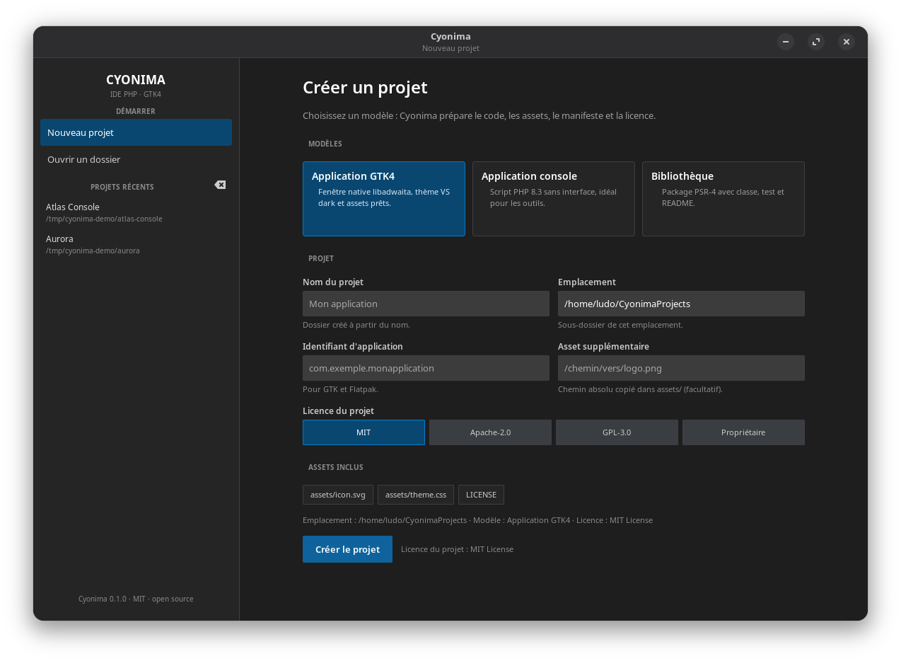
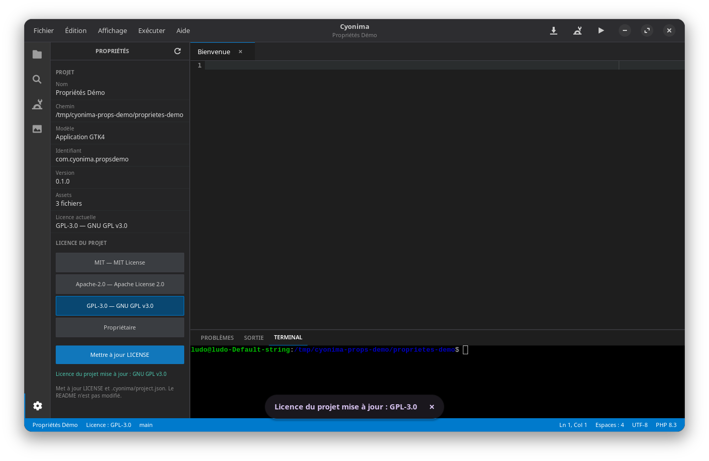
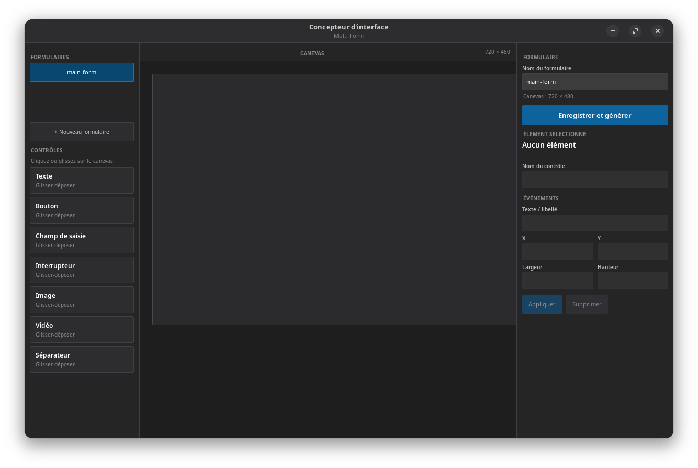
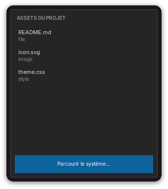
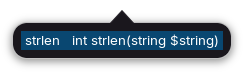

# Design — inspiration Visual Studio

L'interface reprend la disposition et la palette de Visual Studio (thème sombre),
sans dépendre d'Adwaita pour le chrome.

## Disposition

```
┌ menus ·················· Cyonima ················· actions ┐
│ ┌──┐ ┌──────────────┐ ┌──────────────────────────────────┐ │
│ │  │ │ EXPLORER     │ │ onglet                           │ │
│ │  │ │              │ ├──────────────────────────────────┤ │
│ │  │ │  adw.php     │ │                                  │ │
│ │  │ │  async.php   │ │           éditeur                │ │
│ │  │ │  counter.php │ │                                  │ │
│ │  │ │  hello.php   │ │                                  │ │
│ │  │ ├──────────────┤ ├──────────────────────────────────┤ │
│ │  │ │ Pile         │ │ PROBLÈMES SORTIE TERMINAL        │ │
│ │  │ │ Variables    │ │ terminal VTE                     │ │
│ └──┘ └──────────────┘ └──────────────────────────────────┘ │
├────────────────────────────────────────────────────────────┤
│ main              Ln 1, Col 1  Espaces : 4  UTF-8  PHP 8.3 │
└────────────────────────────────────────────────────────────┘
```

Composants :

| Zone | Implémentation |
|---|---|
| Barre de menus | `MenuBar` : boutons + `GtkPopover` |
| Actions | `IconButton` (Enregistrer, Déboguer, Exécuter) |
| Barre d'activité | `Box` vertical de 48 px, icônes symboliques, indicateur bleu |
| Panneau latéral | `EXPLORER`, `RECHERCHE`, `GIT`, `DÉBOGAGE`, `ASSETS` ou `PROPRIÉTÉS` |
| Onglets | un onglet par fichier, point de modification, fermeture, bascule |
| Éditeur | GtkSourceView + schéma `vs-dark` |
| Panneau bas | onglets cliquables PROBLÈMES / SORTIE / DIFF / TERMINAL, diagnostics, journal, diff + VTE |
| Barre de statut | bleue `#007acc`, position, encodage, version PHP |

## Palette

| Rôle | Couleur |
|---|---|
| Fond éditeur | `#1e1e1e` |
| Chrome / barre de titre | `#2d2d30` |
| Panneau latéral | `#252526` |
| Barre d'activité | `#333333` |
| Bordures | `#3f3f46` |
| Texte | `#cccccc` |
| Texte atténué | `#969696` |
| Accent | `#007acc` |
| Sélection de liste | `#094771` |
| Survol de liste | `#2a2d2e` |

## Explorateur redimensionnable

La zone latérale et l'éditeur sont dans un `GtkPaned` horizontal (position
initiale 270 px, largeur minimale 180 px). `resize_start_child=false` : quand on
redimensionne la fenêtre, c'est l'éditeur qui grandit, pas l'explorateur. Le
séparateur se glisse à la souris.

## Git

Le bouton Git de la barre d'activité ouvre le panneau `GIT`. `GitRepository`
découvre la racine du dépôt, lit la branche et le statut porcelain, et expose
indexation, désindexation, commit et diff. Le panneau affiche la branche, le
nombre de modifications et les fichiers avec leurs codes d'état
(`??`, `M`, `A`, `D`…). Chaque ligne propose **Ouvrir**, **Diff** et
**Indexer**/**Désindexer** ; **Indexer tout** reste disponible dans la barre
d'outils. Le champ de message et **Commit** créent le commit des fichiers
indexés. La branche courante remplace le libellé statique dans la barre de
statut, et le statut est rafraîchi après chaque sauvegarde. Les commandes
Git sont aussi disponibles dans la palette : actualiser, indexer tout,
afficher le diff du projet, changer ou créer une branche.

Le bouton de branche ouvre un popover listant les branches locales, la branche
courante étant marquée `●`. Un clic bascule via `git checkout`. Le champ
« Nouvelle branche » et **Créer** lancent `git checkout -b`. Le champ
« Fusionner une branche » et **Fusionner** lancent `git merge --no-edit`.
Après une bascule ou une fusion réussie, le fichier courant est rechargé s'il
n'a pas de modifications non enregistrées.

En cas de conflit, la sortie Git est journalisée dans Sortie, la liste est
rafraîchie et le résumé affiche le nombre de conflits. Les fichiers concernés
sont marqués en rouge et leur bouton d'action devient **Marquer résolu**
(`git add -A -- <fichier>`). Une fois tous les conflits résolus, une
notification rappelle qu'il faut committer pour terminer le merge. Le bouton
**Abandonner** apparaît tant qu'un merge est en cours et lance
`git merge --abort`.

Le diff d'un fichier s'ouvre dans l'onglet **DIFF** du panneau bas
(`DiffPanel`) : vue en lecture seule colorée par GtkSourceView. Les fichiers
suivis affichent leurs diffs indexé et non indexé ; un fichier non suivi est
comparé à `/dev/null` pour montrer son contenu complet.

Limites : pas de rebase, push/pull, suppression ni renommage de branche, pas
d'éditeur de conflits à trois volets ; le diff est textuel, sans édition ni
navigation entre hunks.

## Onglets multiples

L'éditeur conserve un document par fichier dans l'ordre d'ouverture : contenu,
langage, état de modification, ligne et colonne du curseur. Cliquer sur un
onglet ou rouvrir un fichier déjà présent réactive son document sans relire le
disque ; les modifications non enregistrées sont conservées en mémoire. Un
onglet modifié affiche un point et son titre est suffixé `•` dans la barre de
titre. La fermeture (`Ctrl+W` ou croix) est refusée tant que le document est
modifié, pour éviter toute perte. `Ctrl+Tab`, `Ctrl+Shift+Tab`,
`Ctrl+Page_Down` et `Ctrl+Page_Up` font le tour des onglets. Fermer l'onglet
actif active le voisin ; fermer le dernier vide l'éditeur.

Limites : pas de réorganisation par glisser-déposer, pas de barre d'onglets
défilante au-delà de la largeur de la fenêtre, pas d'historique d'annulation
propre à chaque document (le buffer est partagé et son historique est remis à
zéro à la bascule).

## Navigation rapide

`Ctrl+P` ouvre un popover centré avec un champ de recherche. La liste est
rechargée à chaque ouverture à partir des fichiers du projet (mêmes exclusions
et limite de taille que la recherche). Le filtrage est flou : le nom de fichier
exact, puis son préfixe, puis une sous-chaîne, puis une sous-séquence de
caractères ; les correspondances en début de segment (`/`, `-`, `_`, `.`) sont
favorisées. Les flèches parcourent les résultats, Entrée ou un clic ouvre le
fichier dans un onglet, Échap ou un clic extérieur ferme le popover. Les 50
premiers résultats sont affichés.

## Palette de commandes

`Ctrl+Shift+P` ouvre la palette de commandes, construite sur le même popover
que la navigation rapide (`QuickPick`). Le filtre flou s'applique aux libellés
préfixés par leur domaine (`Fichier :`, `Affichage :`, `Exécuter :`,
`Exporter :`, `Aide :`). Chaque commande affiche son raccourci quand il existe ;
Entrée ou un clic exécute l'action après fermeture de la palette. Les commandes
couvrent l'enregistrement, les onglets, la navigation, les panneaux, le
concepteur, le terminal, l'exécution, la compilation native, le débogage, les
exports et l'aide.

## Problèmes LSP

Les notifications `textDocument/publishDiagnostics` alimentent `Diagnostics`,
qui agrège les entrées par fichier et les trie par chemin, ligne et colonne.
Le panneau `ProblemsPanel` affiche `chemin:ligne:colonne`, la sévérité et le
message ; un clic ouvre le fichier à la ligne. L'onglet `PROBLÈMES` affiche le
nombre courant, `SORTIE` reste un espace réservé et `TERMINAL` garde le VTE.
Les diagnostics vides retirent le fichier de la liste ; une sévérité inconnue
est ramenée à « Information ». Le résumé distingue erreurs et avertissements.

## Sortie

`OutputPanel` journalise les actions de processus dans un `OutputLog`
horodaté : exécution de fichier (terminal), compilation native (ELF ou C
généré), export AppImage/Flatpak. Chaque ligne peut porter un canal (`IDE`,
`Exécuter`, `Compiler`, `Export`), le journal est borné à 2 000 entrées et
défile automatiquement vers le bas. L'export est asynchrone : son code de
sortie, sa durée et ses sorties standard/erreur sont ajoutés à la fin. Un
bouton `Vider` et la commande de palette `Sortie : vider` remettent le journal
à zéro.

## Recherche de symboles

`Ctrl+T` ouvre une recherche de définitions PHP du projet, construite sur le
même popover que Ctrl+P. `SymbolIndex` parcourt les fichiers `.php` avec
`token_get_all` et relève classes, interfaces, traits, énumérations, fonctions
et méthodes, en tenant compte de l'espace de noms et de la classe englobante.
Chaque entrée affiche le nom qualifié, le type et `chemin:ligne` ; le choix
ouvre le fichier à la ligne. Les définitions conditionnelles, les fermetures et
les classes anonymes ne sont pas indexées ; le résultat est limité à 5 000
symboles.

L'index est conservé en mémoire et incrémental : chaque fichier est identifié
par sa taille et sa date de modification, et n'est réanalysé que s'il change.
Les fichiers disparus sont retirés du cache. Une sauvegarde ou un remplacement
projet invalide les fichiers concernés pour forcer leur réanalyse à la
prochaine ouverture de Ctrl+T.

## Surveillance du projet

`WorkspaceWatcher` crée un `GFileMonitor` Gio par dossier du projet, en
excluant les mêmes répertoires que la recherche (`vendor`, `node_modules`,
`dist`, `build`, `.git`), avec un plafond de 200 dossiers. Les événements sont
regroupés pendant 200 ms, puis l'IDE rafraîchit l'explorateur, invalide les
fichiers touchés dans l'index de symboles et relit le statut Git. La création
ou la suppression de dossiers reconstruit les moniteurs. Les moniteurs sont
annulés à la fermeture de la fenêtre.

Les bindings Gio ne sont pas générés : `FileWatcher` déclare le strict
nécessaire en FFI (`libgio-2.0.so.0`) et garde le callback PHP en vie. Si Gio
est indisponible, la surveillance est désactivée sans bloquer l'IDE.

## Rechercher et remplacer

`Ctrl+F` ouvre la barre de recherche au-dessus de l'éditeur, `Ctrl+H` sa
variante avec remplacement. La recherche locale accepte la casse, le mot
entier et les expressions régulières ; `Entrée`/`Maj+Entrée` parcourent les
occurrences avec bouclage, et le compteur affiche `position/total`.
**Remplacer** traite l'occurrence sélectionnée, **Tout remplacer** applique les
remplacements de la fin vers le début pour préserver les offsets, en conservant
l'historique d'annulation. En mode expression régulière, les références arrière
(`$1`, `$2`…) sont développées occurrence par occurrence ; hors regex, le
remplacement est strictement littéral (un `$1` saisi reste `$1`). Toutes les
occurrences sont surlignées via deux `GtkTextTag` (courante en orange, autres
en brun), dans la limite de 500 surlignages ; les tags sont retirés à la
fermeture. `Échap` ferme la barre et rend le focus à l'éditeur. Les
remplacements passent par `CodeEditor::replaceRange` et déclenchent les signaux
normaux de modification. Les requêtes exécutées sont mémorisées dans
`~/.config/cyonima/search-history.json` (20 entrées, dédupliquées) :
`Alt+↑`/`Alt+↓` parcourent l'historique, le bouton dédié ouvre une liste
déroulante filtrable des requêtes récentes (même popover que Ctrl+P), et la
palette permet de vider l'historique.

## Aperçu Markdown

`Ctrl+Shift+V` (ou Affichage → Aperçu Markdown) ouvre un volet d'aperçu à
droite de l'éditeur pour les fichiers `.md`. `Markdown::toPango` rend un
sous-ensemble : titres, gras, italique, code inline, blocs de code, listes,
citations, liens, images (affichées comme texte) et règles horizontales. Le
texte est échappé avant l'application des styles, donc le HTML brut reste
affiché littéralement. L'aperçu se rafraîchit à chaque modification et suit la
bascule d'onglet ; il se ferme automatiquement quand le fichier actif n'est
plus du Markdown. Le rendu est natif (Pango), sans WebKit. Un bouton
**Sommaire (N)** liste les titres numérotés (`1`, `1.1`, `1.2`, `2`…) avec
leur niveau ; les sections parentes se replient/déplient via une flèche et un
clic sur un titre positionne l'éditeur et l'aperçu sur la ligne
correspondante. Le défilement vertical est synchronisé avec l'éditeur : une
cartographie ligne source → ligne affichée (établie pendant le rendu) permet un
alignement par bloc plutôt qu'une simple proportion, avec verrou anti-rétroaction
et resynchronisation à l'ouverture.

Limites : pas de tableaux, de cases à cocher ni de HTML rendu ; les liens sont
affichés mais pas ouverts par clic.

## Recherche projet

Le bouton loupe de la barre d'activité ouvre le panneau `RECHERCHE`. La requête
est lancée par Entrée ou par le bouton ; `ProjectSearch` parcourt récursivement
les fichiers texte du projet (1 Mio max, `vendor`, `node_modules`, `dist`,
`build`, `build-dir` et `.git` exclus). Chaque résultat affiche
`chemin:ligne  extrait` et un clic ouvre le fichier dans l'éditeur avec le
curseur positionné sur la ligne. La recherche est limitée à 200 résultats ; il
n'y a ni index ni remplacement sélectif pour l'instant.

Trois bascules s'appliquent à la recherche et au remplacement : casse (`Aa`),
mot entier (`Ab|`) et expression régulière (`.*`). Le champ « Remplacer par »
et le bouton « Tout remplacer » réécrivent toutes les occurrences des fichiers
correspondants, puis rafraîchissent la liste. L'IDE affiche le bilan et
recharge le fichier courant s'il a été modifié, sauf s'il reste des
modifications non enregistrées.

## Fenêtre de démarrage



Le lancement sans argument affiche un choix de modèles à gauche et un formulaire
à droite, comme la fenêtre de création de Visual Studio. Les projets récents
sont listés dans la barre latérale et ouvrables en un clic.

La création écrit un environnement complet (`.cyonima/project.json`, `src/`,
`assets/`, `LICENSE`, `README.md`) puis lance l'IDE dans un processus séparé avec
`--project`. La fenêtre de démarrage se ferme : chaque projet a son propre
environnement.

## Licences des projets

Le formulaire de création choisit la licence du projet : MIT, Apache-2.0,
GPL-3.0 ou propriétaire. Le texte est écrit dans `LICENSE` et le manifeste
enregistre l'identifiant SPDX. Cyonima IDE reste sous licence MIT, sans activation
ni fonctionnalité payante.

La vue **PROPRIÉTÉS** (icône engrenage de la barre d'activité) affiche nom,
chemin, modèle, identifiant, version et nombre d'assets. Elle permet de changer
la licence après création : `LICENSE` et le manifeste sont réécrits, puis la
barre de statut est actualisée.



## Assets


Troisième vue du panneau latéral : elle liste `assets/` avec type et taille,
importe un fichier (chemin relatif au projet ou absolu), rafraîchit le manifeste
et ouvre l'asset dans l'éditeur. L'icône SVG et le thème CSS générés servent
d'exemple ; `assets/theme.css` est chargé par l'application GTK produite.

## Menus


La barre de menus est fonctionnelle : chaque titre ouvre un `GtkPopover` ancré
à son bouton. Une fois un menu ouvert, survoler un autre titre bascule
directement dessus, comme dans Visual Studio. Les actions couvrent les
opérations réelles de l'IDE.

| Menu | Actions |
|---|---|
| Fichier | Enregistrer, Fermer l'onglet, onglet suivant/précédent, Quitter |
| Édition | Annuler, Rétablir, Rechercher, Remplacer, Tout sélectionner |
| Affichage | Palette de commandes, Explorateur, Recherche, Git, changer de branche, fusionner une branche, Problèmes, Sortie, Diff, Aperçu Markdown, Aller au fichier, rechercher un symbole, Débogage, Assets, Propriétés, terminal |
| Exécuter | Exécuter le fichier, Déboguer, Arrêter le débogage |
| Aide | Raccourcis clavier, À propos, Licence MIT |

Raccourcis : `Ctrl+S`, `Ctrl+F`, `Ctrl+H`, `Ctrl+P`, `Ctrl+T`, `Ctrl+Shift+P`,
`Ctrl+Shift+V`, `Ctrl+W`, `Ctrl+Tab` / `Ctrl+Shift+Tab`, `Ctrl+Z`,
`Ctrl+Shift+Z`/`Ctrl+Y`, `Ctrl+A`, `Ctrl+Espace` et `F5`.

## Concepteur d'interface



Fenêtre séparée, ouverte depuis l’icône pinceau ou le menu **Affichage**, avec
trois zones :

| Zone | Contenu |
|---|---|
| Palette | formulaires du projet + texte, bouton, champ, interrupteur, image, vidéo, séparateur |
| Canevas | `GtkFixed` 720 × 480, dépôt et déplacement des contrôles |
| Propriétés | nom, texte, image du bouton, position, taille, événements, suppression |

Le dépôt utilise `GtkGestureDrag` : les coordonnées sont converties du bouton
de palette vers le canevas avec `gtk_widget_compute_point()`. Les contrôles
placés reçoivent un cadre de sélection ; un glissement met à jour leur position.

La palette liste les formulaires déjà présents dans
`.cyonima/forms/` et permet d’en créer d’autres. Changer de formulaire
enregistre silencieusement le formulaire courant avant de charger le suivant.
Les images (`GtkImage`) et vidéos (`GtkVideo`) utilisent un chemin d’asset
relatif au projet ; la vidéo nécessite les codecs GStreamer de la machine. Un
bouton peut recevoir une image via **Image du bouton** ; le générateur compose
alors `Image` + `Label` dans un `Box` placé dans le bouton.

Le bouton **Choisir un fichier** ouvre un `AssetPicker` ancré, qui liste les
fichiers de `assets/` et propose **Parcourir le système…** via `GtkFileDialog`.
Le chemin sélectionné est converti en chemin relatif au projet quand il se
trouve sous la racine.



**Enregistrer et générer** écrit `.cyonima/forms/<nom>.form.json`,
`src/Forms/<Nom>Base.php` et `src/Forms/<Nom>.php`. Le nom d’un contrôle devient
une propriété PHP publique de la classe de base ; les événements cochés
(`Sur clic`, `Sur double-clic`, `Sur modification`, `Sur activation`) sont
câblés vers des méthodes `on<Nom><Événement>()` que le développeur implémente
dans la sous-classe utilisateur, préservée entre les générations.

## IntelliSense


Après filtrage local (préfixe `strl`), la liste ne garde que `strlen` et se
redimensionne :



- déclenchement automatique **180 ms** après une frappe quand le préfixe fait
  au moins 2 caractères (ou après `.`/`>` quand un serveur LSP est actif) ;
- `Ctrl+Espace` force la liste ;
- popup **ancré au curseur** : `gtk_text_view_get_cursor_locations()` +
  `gtk_popover_set_pointing_to()` ;
- **sans LSP** : suggestions PHP intégrées (`PhpIntellisense`) — mots-clés et
  fonctions avec signatures ;
- **avec LSP** : résultats du serveur, repli local si la réponse est vide ;
- **filtrage local pendant la frappe** : tant que le préfixe s'allonge, la
  liste est filtrée sans nouvelle requête. Le popover est masqué pendant la
  frappe (l'éditeur garde le focus), puis réaffiché **90 ms** après la dernière
  touche avec la taille correcte ;
- une nouvelle requête n'est faite que si le préfixe est raccourci, change de
  mot, ou si la liste est fermée ;
- après insertion, une fenêtre de suppression de 400 ms évite le
  redéclenchement (le buffer émet deux signaux `changed`).

## Schéma d'éditeur

`src/UI/Theme.php` embarque un schéma GtkSourceView `vs-dark` (XML) et l'installe
au démarrage :

1. écriture dans `$TMPDIR/cyonima-styles/vs-dark.xml` ;
2. `append_search_path()` puis `force_rescan()` sur le gestionnaire de schémas ;
3. repli sur `Adwaita-dark` si le chargement échoue.

Les couleurs suivent VS Dark : mots-clés `#569cd6`, chaînes `#ce9178`,
commentaires `#6a9955`, types `#4ec9b0`, fonctions `#dcdcaa`, variables
`#9cdcfe`.

## Personnalisation

Tout le chrome est dans la constante `Theme::CSS` : classes `.activity-bar`,
`.side-panel`, `.panel-header`, `.tab`, `.statusbar`, `.menu-item`. Modifier la
constante suffit à changer le thème, aucune ressource externe n'est requise.

## Écarts assumés avec Visual Studio

- les menus (Fichier, Édition, Affichage…) déclenchent les actions principales,
  mais restent gérés par l'IDE plutôt que par des `GAction` partagées ;
- la barre de titre garde les boutons de fenêtre GNOME, simplement aplatis ;
- la recherche projet est un parcours de fichiers sans index ni aperçu diff ;
- les onglets ne se réorganisent pas par glisser-déposer et ne défilent pas ;
- la recherche de symboles ne voit que les définitions statiques, pas les
  constantes, propriétés ni membres dynamiques ;
- la palette ne mémorise pas les commandes récentes et ne permet pas de
  personnaliser les raccourcis ;
- l'intégration Git couvre le statut local et le commit, pas les branches
  distantes ni les conflits ;
- pas encore de gestion de solutions (plusieurs projets dans une même session) ;
- les couleurs du terminal VTE viennent du thème système, pas du CSS.
