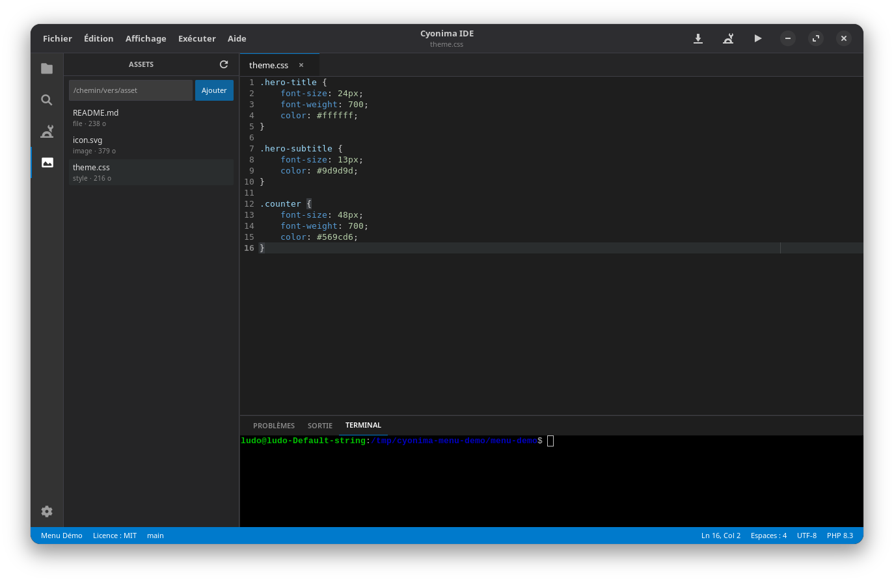
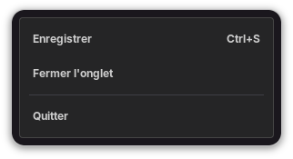
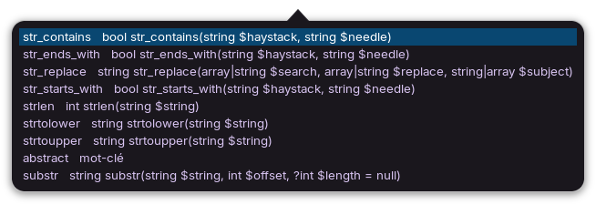

# Design — inspiration Visual Studio

L'interface reprend la disposition et la palette de Visual Studio (thème sombre),
sans dépendre d'Adwaita pour le chrome.

## Disposition

```
┌ menus ·················· Cyonima ················· actions ┐
│ ┌──┐ ┌──────────────┐ ┌──────────────────────────────────┐ │
│ │  │ │ EXPLORER     │ │ onglet                           │ │
│ │  │ │              │ ├──────────────────────────────────┤ │
│ │  │ │  adw.php     │ │                                  │ │
│ │  │ │  async.php   │ │           éditeur                │ │
│ │  │ │  counter.php │ │                                  │ │
│ │  │ │  hello.php   │ │                                  │ │
│ │  │ ├──────────────┤ ├──────────────────────────────────┤ │
│ │  │ │ Pile         │ │ PROBLÈMES SORTIE TERMINAL        │ │
│ │  │ │ Variables    │ │ terminal VTE                     │ │
│ └──┘ └──────────────┘ └──────────────────────────────────┘ │
├────────────────────────────────────────────────────────────┤
│ main              Ln 1, Col 1  Espaces : 4  UTF-8  PHP 8.3 │
└────────────────────────────────────────────────────────────┘
```

Composants :

| Zone | Implémentation |
|---|---|
| Barre de menus | `MenuBar` : boutons + `GtkPopover` |
| Actions | `IconButton` (Enregistrer, Déboguer, Exécuter) |
| Barre d'activité | `Box` vertical de 48 px, icônes symboliques, indicateur bleu |
| Panneau latéral | `EXPLORER`, `DÉBOGAGE`, `ASSETS` ou `PROPRIÉTÉS` |
| Onglet | nom du fichier, point de modification, fermeture |
| Éditeur | GtkSourceView + schéma `vs-dark` |
| Panneau bas | onglets PROBLÈMES / SORTIE / TERMINAL + VTE |
| Barre de statut | bleue `#007acc`, position, encodage, version PHP |

## Palette

| Rôle | Couleur |
|---|---|
| Fond éditeur | `#1e1e1e` |
| Chrome / barre de titre | `#2d2d30` |
| Panneau latéral | `#252526` |
| Barre d'activité | `#333333` |
| Bordures | `#3f3f46` |
| Texte | `#cccccc` |
| Texte atténué | `#969696` |
| Accent | `#007acc` |
| Sélection de liste | `#094771` |
| Survol de liste | `#2a2d2e` |

## Explorateur redimensionnable

La zone latérale et l'éditeur sont dans un `GtkPaned` horizontal (position
initiale 270 px, largeur minimale 180 px). `resize_start_child=false` : quand on
redimensionne la fenêtre, c'est l'éditeur qui grandit, pas l'explorateur. Le
séparateur se glisse à la souris.

## Fenêtre de démarrage


Le lancement sans argument affiche un choix de modèles à gauche et un formulaire
à droite, comme la fenêtre de création de Visual Studio. Les projets récents
sont listés dans la barre latérale et ouvrables en un clic.

La création écrit un environnement complet (`.cyonima/project.json`, `src/`,
`assets/`, `LICENSE`, `README.md`) puis lance l'IDE dans un processus séparé avec
`--project`. La fenêtre de démarrage se ferme : chaque projet a son propre
environnement.

## Licences des projets

Le formulaire de création choisit la licence du projet : MIT, Apache-2.0,
GPL-3.0 ou propriétaire. Le texte est écrit dans `LICENSE` et le manifeste
enregistre l'identifiant SPDX. Cyonima IDE reste sous licence MIT, sans activation
ni fonctionnalité payante.

La vue **PROPRIÉTÉS** (icône engrenage de la barre d'activité) affiche nom,
chemin, modèle, identifiant, version et nombre d'assets. Elle permet de changer
la licence après création : `LICENSE` et le manifeste sont réécrits, puis la
barre de statut est actualisée.


## Assets



Troisième vue du panneau latéral : elle liste `assets/` avec type et taille,
importe un fichier (chemin relatif au projet ou absolu), rafraîchit le manifeste
et ouvre l'asset dans l'éditeur. L'icône SVG et le thème CSS générés servent
d'exemple ; `assets/theme.css` est chargé par l'application GTK produite.

## Menus



La barre de menus est fonctionnelle : chaque titre ouvre un `GtkPopover` ancré
à son bouton. Une fois un menu ouvert, survoler un autre titre bascule
directement dessus, comme dans Visual Studio. Les actions couvrent les
opérations réelles de l'IDE.

| Menu | Actions |
|---|---|
| Fichier | Enregistrer, Fermer l'onglet, Quitter |
| Édition | Annuler, Rétablir, Tout sélectionner |
| Affichage | Explorateur, Débogage, Assets, Propriétés, terminal |
| Exécuter | Exécuter le fichier, Déboguer, Arrêter le débogage |
| Aide | Raccourcis clavier, À propos, Licence MIT |

Raccourcis : `Ctrl+S`, `Ctrl+Z`, `Ctrl+Shift+Z`/`Ctrl+Y`, `Ctrl+A`,
`Ctrl+Espace` et `F5`.

## Concepteur d'interface


Fenêtre séparée, ouverte depuis l’icône pinceau ou le menu **Affichage**, avec
trois zones :

| Zone | Contenu |
|---|---|
| Palette | formulaires du projet + texte, bouton, champ, interrupteur, image, vidéo, séparateur |
| Canevas | `GtkFixed` 720 × 480, dépôt et déplacement des contrôles |
| Propriétés | nom, texte, image du bouton, position, taille, événements, suppression |

Le dépôt utilise `GtkGestureDrag` : les coordonnées sont converties du bouton
de palette vers le canevas avec `gtk_widget_compute_point()`. Les contrôles
placés reçoivent un cadre de sélection ; un glissement met à jour leur position.

La palette liste les formulaires déjà présents dans
`.cyonima/forms/` et permet d’en créer d’autres. Changer de formulaire
enregistre silencieusement le formulaire courant avant de charger le suivant.
Les images (`GtkImage`) et vidéos (`GtkVideo`) utilisent un chemin d’asset
relatif au projet ; la vidéo nécessite les codecs GStreamer de la machine. Un
bouton peut recevoir une image via **Image du bouton** ; le générateur compose
alors `Image` + `Label` dans un `Box` placé dans le bouton.

Le bouton **Choisir un fichier** ouvre un `AssetPicker` ancré, qui liste les
fichiers de `assets/` et propose **Parcourir le système…** via `GtkFileDialog`.
Le chemin sélectionné est converti en chemin relatif au projet quand il se
trouve sous la racine.


**Enregistrer et générer** écrit `.cyonima/forms/<nom>.form.json`,
`src/Forms/<Nom>Base.php` et `src/Forms/<Nom>.php`. Le nom d’un contrôle devient
une propriété PHP publique de la classe de base ; les événements cochés
(`Sur clic`, `Sur double-clic`, `Sur modification`, `Sur activation`) sont
câblés vers des méthodes `on<Nom><Événement>()` que le développeur implémente
dans la sous-classe utilisateur, préservée entre les générations.

## IntelliSense



Après filtrage local (préfixe `strl`), la liste ne garde que `strlen` et se
redimensionne :


- déclenchement automatique **180 ms** après une frappe quand le préfixe fait
  au moins 2 caractères (ou après `.`/`>` quand un serveur LSP est actif) ;
- `Ctrl+Espace` force la liste ;
- popup **ancré au curseur** : `gtk_text_view_get_cursor_locations()` +
  `gtk_popover_set_pointing_to()` ;
- **sans LSP** : suggestions PHP intégrées (`PhpIntellisense`) — mots-clés et
  fonctions avec signatures ;
- **avec LSP** : résultats du serveur, repli local si la réponse est vide ;
- **filtrage local pendant la frappe** : tant que le préfixe s'allonge, la
  liste est filtrée sans nouvelle requête. Le popover est masqué pendant la
  frappe (l'éditeur garde le focus), puis réaffiché **90 ms** après la dernière
  touche avec la taille correcte ;
- une nouvelle requête n'est faite que si le préfixe est raccourci, change de
  mot, ou si la liste est fermée ;
- après insertion, une fenêtre de suppression de 400 ms évite le
  redéclenchement (le buffer émet deux signaux `changed`).

## Schéma d'éditeur

`src/UI/Theme.php` embarque un schéma GtkSourceView `vs-dark` (XML) et l'installe
au démarrage :

1. écriture dans `$TMPDIR/cyonima-styles/vs-dark.xml` ;
2. `append_search_path()` puis `force_rescan()` sur le gestionnaire de schémas ;
3. repli sur `Adwaita-dark` si le chargement échoue.

Les couleurs suivent VS Dark : mots-clés `#569cd6`, chaînes `#ce9178`,
commentaires `#6a9955`, types `#4ec9b0`, fonctions `#dcdcaa`, variables
`#9cdcfe`.

## Personnalisation

Tout le chrome est dans la constante `Theme::CSS` : classes `.activity-bar`,
`.side-panel`, `.panel-header`, `.tab`, `.statusbar`, `.menu-item`. Modifier la
constante suffit à changer le thème, aucune ressource externe n'est requise.

## Écarts assumés avec Visual Studio

- les menus (Fichier, Édition…) sont décoratifs pour l'instant ;
- la barre de titre garde les boutons de fenêtre GNOME, simplement aplatis ;
- pas encore de panneau Recherche ni de gestion de solutions ;
- les couleurs du terminal VTE viennent du thème système, pas du CSS.
